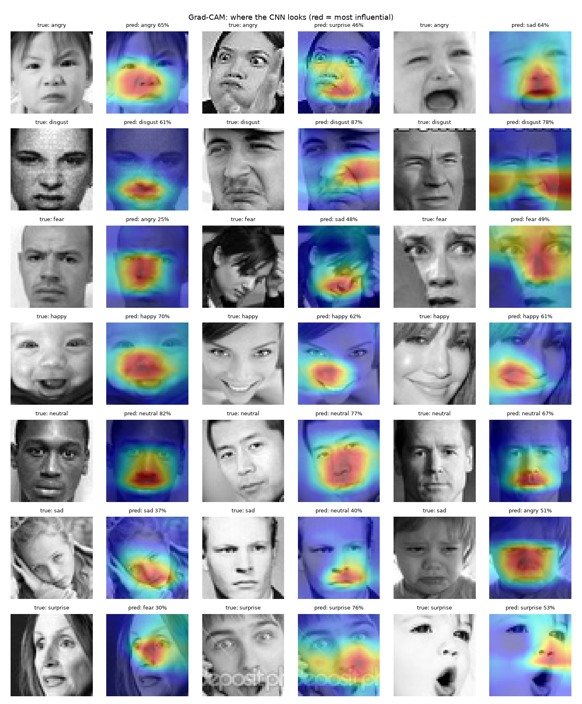

# Emotion-Aware Santa 🎅

Real-time webcam Santa filter that reacts to your facial emotion. The emotion classifiers are **trained from scratch** on FER2013 (not an API call): a custom CNN on face pixels and a landmark-based MLP, compared head to head.


## How it works
Webcam -> MediaPipe Face Landmarker (face + 468 landmarks) -> face crop -> **custom CNN** -> temporal smoothing (EMA) -> Santa hat/beard drawn on landmarks + emotion reactions (happy: confetti, surprise: gifts, sad/fear/neutral: snow, angry: naughty list, disgust: coal).

## Results
Data: FER2013 train + test pooled, then **stratified 70/15/15** split (so numbers are not comparable to the official benchmark split). Both models use class weights (disgust is ~16x rarer than happy) and label smoothing.

| Model | Input | Test accuracy | Macro-F1 |
|---|---|---|---|
| CNN (4 conv blocks, BatchNorm, Dropout) | 48x48 grayscale pixels, all test images | 64.6% | 0.607 |
| MLP (1404 -> 512 -> 256 -> 128 -> 7) | normalized MediaPipe landmarks, detected faces only (~91.5%) | 56.8% | 0.498 |

CNN: up to 50 epochs with early stopping (best validation macro-F1 at epoch 33), AdamW + ReduceLROnPlateau; the 30-epoch run scored 63.7% / 0.591.

MLP strict accuracy (undetected faces counted as wrong): 52.0%. MLP inference: 0.08 ms/face on CPU (excludes MediaPipe).

Plots: `models/cnn_confusion.png`, `models/cnn_curves.png`, `models/mlp_confusion.png`, `models/mlp_curves.png`.

## Findings
- Happy and surprise are recognized best (clear facial geometry/texture cues).
- Fear is weakest: it overlaps with sad, surprise and neutral, a known FER2013 issue (noisy labels).
- Landmarks alone lose texture cues, so the MLP trails the CNN on subtle emotions.

## Limitations
- FER2013 labels are noisy and faces are 48x48 grayscale, so ~60-65% is typical.
- Trained on posed/web images; webcam lighting and angles can reduce accuracy.
- Emotion labels are a fun filter, not a reliable measure of how someone feels.

## Run it
```bash
python3 -m venv venv && source venv/bin/activate && pip install -r requirements.txt
curl -L -o models/face_landmarker.task https://storage.googleapis.com/mediapipe-models/face_landmarker/face_landmarker/float16/1/face_landmarker.task
# download FER2013 (kaggle datasets download -d msambare/fer2013 -p data --unzip), then:
python src/train_cnn.py        # trains CNN, writes models/cnn_best.pt
python src/extract_landmarks.py && python src/train_mlp.py
python src/live_santa.py       # q = quit, s = save photo
```

## Stack
Python, PyTorch, OpenCV, MediaPipe, scikit-learn, NumPy, Matplotlib

## Explainability (Grad-CAM)
Grad-CAM on the CNN's last conv block shows which face regions drive each prediction (red = most influential).



## Ensemble ablation (CNN + MLP)
Averaged class probabilities, `w * CNN + (1 - w) * MLP`, with `w` chosen on the validation set (best w = 1.0).

| Test subset | CNN | MLP | Ensemble |
|---|---|---|---|
| Faces detected by MediaPipe (4926) | 65.6% / F1 0.608 | 56.8% / F1 0.498 | 65.6% / F1 0.608 |
| All 5384 images (CNN fallback when no face) | 64.6% / F1 0.607 | n/a | 64.6% / F1 0.607 |

Gain on detected faces: +0.0 points. The validation search picked w = 1.0, meaning the MLP gets zero weight and the ensemble reduces to the CNN alone (identical test numbers). Landmark geometry adds no information beyond what the CNN already learns. The live demo uses the CNN only.
